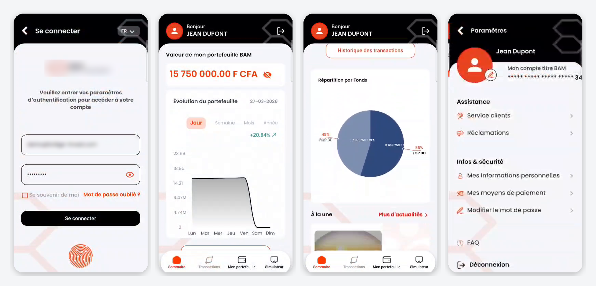
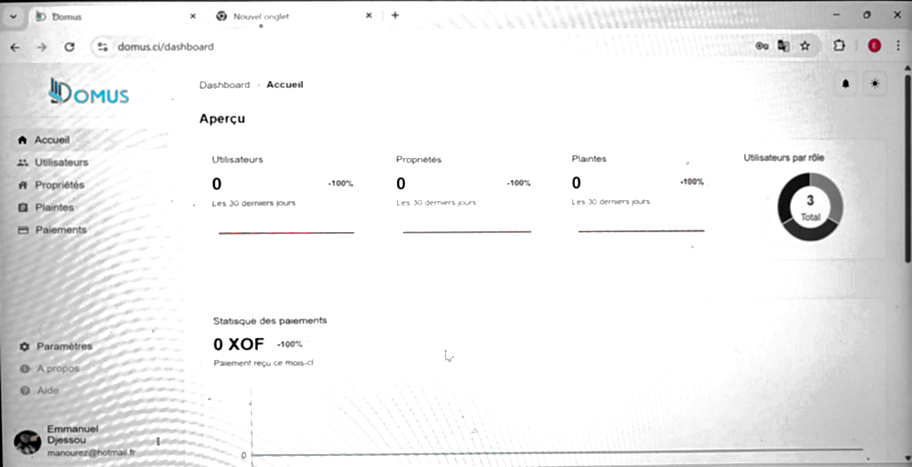

<h1 align="center">Hi, I'm Emmanuel Djessou 👋</h1>

  <b>Full-stack developer — NestJS · React & React Native · Angular · CI/CD on Linux</b> 
  Abidjan, Côte d'Ivoire · GMT (same hours as London, 1h behind Paris) · English & French

  
  
  
  

---

### About me

Fullstack engineer with **6+ years of experience** building web and mobile products end to end — API design, front-ends, database and production deployment.

- 🏦 Most of my work is B2B platforms for **banks, telecom operators and national institutions**, several turned from a single-client build into a product sold to multiple customers
- 👥 I've led a small team and delivered full applications on my own
- 📱 Shipped full-stack products combining a NestJS API, a React web back-office and a React Native mobile app in a single monorepo
- 🚀 I handle my own deployments: Linux servers, GitHub Actions pipelines (push / PR → automatic deploy), Docker
- ⏱️ **Available ~30 h/week** for remote freelance or part-time contracts (hourly)

### What I can do for you

| | |
|---|---|
| **Backend** | NestJS APIs (JWT auth, CQRS, scheduled jobs, emails, Swagger docs), Prisma, PostgreSQL & SQL Server, file storage on S3 |
| **Web** | React (MUI, data grids, charts, forms) and Angular apps, admin dashboards, PDF & Excel exports |
| **Mobile** | React Native / Expo: camera, biometrics, OTP, e-signature, real-time updates, OTA updates |
| **Light DevOps** | CI/CD with GitHub Actions, Linux server setup, Nginx, Dockerfiles & Compose, Nx monorepos |

### Tech stack

  

Also: React Native / Expo, Redux Toolkit, Nx, SQL Server (MSSQL), Jest / Vitest / Cypress.

### Selected client projects

Built for clients — source code is private. Demo and details available on request.

#### 📈 Mutual-fund investment app — for a bank
Mobile app for the bank's mutual-fund (FCP) investors: fund subscription, portfolio tracking and redemptions, with digital onboarding (on-device face detection), biometric login, OTP verification, electronic signature and real-time updates.
`React Native` `Expo` `TypeScript` `TensorFlow.js` `Redux Toolkit`

#### 🏠 Domus — property management platform · [domus.ci](https://domus.ci)
Platform for homeowners and landlords to manage properties, tenants and rent from the web or their phone, with PDF rent receipts, Excel exports, dashboards and email notifications. Nx monorepo: NestJS API, React back-office and Expo mobile app sharing one codebase.
`NestJS` `Prisma` `React` `MUI` `Expo` `AWS S3` `Nx`

#### Earlier highlights
- **Bank transaction-notification platform**, later sold to other banks — NestJS microservices, RabbitMQ, core-banking integration
- **Bulk SMS platform rewrite** serving MTN and West African banks (1M+ messages/day) — TypeScript, CQRS
- **Two-factor authentication API** in production for a national postal operator, 80%+ test coverage — led a team of three
- **National passport & visa appointment APIs**, rebuilt and secured, all endpoints under 500 ms

---

🇫🇷 <b>En français</b>

 

Développeur full-stack basé à Abidjan (GMT). Je conçois des produits web et mobiles de bout en bout : API NestJS, front React ou Angular, mobile React Native / Expo, et mise en production (serveurs Linux, CI/CD GitHub Actions, Docker).

**Disponible environ 30 h/semaine** pour des missions freelance ou à temps partiel en remote, facturées à l'heure. Contact : [LinkedIn](https://www.linkedin.com/in/emmanuel-djessou), [portfolio](https://manourez.github.io) ou [email](mailto:manourez@hotmail.fr).

